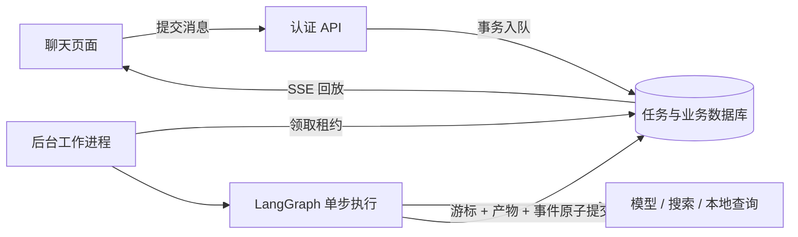

# 六项架构完成记录

本轮在现有四角色与 16 个工具基础上完成六项架构接入。v1 保持兼容；v2 页面为 `/chat`，首页有入口。
所有验收使用隔离数据库和合成考生/院校，不写入真实录取数据。真实模型和 Tavily 密钥未配置，未执行真实模型或搜索调用。

## 1. 状态、协议与迁移

新增执行轮次 `agent_runs_v2`、步骤 `run_steps_v2`、子任务 `agent_subtasks_v2`、
事件 `run_events_v2`、产物 `agent_artifacts_v2`、来源 `agent_sources_v2`、
用户画像 `user_knowledge_v2`、用户记忆 `user_memories_v2`、招生规则 `admission_policies_v2` 和迁移记录表。
会话保留画像、对话、候选及产物编号投影；来源、完整产物、子任务和请求历史独立存储。

`ArtifactEnvelope` 在生成和保存时校验任务、执行轮次、画像版本、数据版本。
实际报告生成 `EvidencePack`，方案生成 `PlanDraft`，交接调用 `validate_handoff`；
审核使用 `ReviewReport`，专家委派使用 `Subtask`。泛专业研究允许没有具体候选或未知年份。
数据库事实只能由工具提供，来源快照与已提交产物不可覆盖。

启动执行幂等迁移：创建新增表，将旧会话的来源/产物/请求/记忆转入新表，保留原业务数据。
旧引擎没有执行游标的活动请求只能记录中断；新引擎创建的任务具有恢复游标。
部署前应备份 SQLite 文件；迁移应在旧进程停止后执行。没有删除现有表或清空录取数据。

## 2. 持久执行



消息提交默认立即返回 `202` 和任务编号。后台执行不依赖 HTTP 连接。
工作进程用租约领取任务并续约，旧所有者不能在租约丢失后写入结果；过期任务可被重新领取。
正常退出会将未完成任务重新入队，异常退出最多等待约 30 秒租约过期。
同一用户暂限一个活动任务，以保证跨会话记忆和画像的一致性。

每次模型请求前保存预算；模型返回后保存待执行工具列表；每个工具完成后，
在同一事务中保存业务产物、已执行位置、子任务状态和事件。
重启后继续尚未提交的步骤，不重复已提交的记忆、报告和方案。
恢复模型上下文使用用户消息、工具事实和产物，不保存或重放隐藏思考内容。
尚未完成的模型请求/搜索可能重新调用，因此不承诺外部服务只调用或计费一次。

每轮仍限制 24 次模型决策、48 次工具、8 次搜索和约 300 秒累计执行时间；
专家最多 8 次模型调用。工作进程默认最多领取/重试 3 次，网络/限流/服务端错误才自动重试；
认证或输入错误直接失败。未提交调用在异常退出前经过的时间不能精确恢复，调用数和领取次数仍有限制。
取消通过持久标记、续约检查和提交检查生效；已保存结果保留，之后不再提交新步骤。

运行方式：

```bash
# 项目根目录，默认同进程启动独立于请求的后台任务
cd backend
../.venv/bin/python -m uvicorn main:app --host 127.0.0.1 --port 8000
```

也可分开 API 和工作进程（两个终端、相同 DATABASE_URL）：

```bash
# 终端一，在 backend 目录
AGENT_EMBEDDED_WORKER=false ../.venv/bin/python -m uvicorn main:app --host 127.0.0.1 --port 8000
```

```bash
# 终端二，在 backend 目录
../.venv/bin/python -m services.run_worker
```

当前数据库仍为 SQLite。v2 具有进程间租约保护，但未完成高并发压测；整应用包含旧 v1 执行器，仍按单个 Uvicorn worker 部署。

## 3. 接口与前端

所有 v2 接口沿用 Bearer 认证和用户归属检查。

| 接口 | 用途 |
| --- | --- |
| `GET/POST /api/v2/agent/sessions` | 列出或创建会话 |
| `GET /api/v2/agent/sessions/{sid}` | 对话、来源、报告、方案版本、任务状态 |
| `POST /api/v2/agent/sessions/{sid}/messages` | 异步提交，`request_id` 幂等；同编号不同内容返回 409 |
| `GET /api/v2/agent/runs/{rid}` | 任务状态与最终结果 |
| `GET /api/v2/agent/runs/{rid}/events?after=N` | SSE 增量回放，也支持 `Last-Event-ID` |
| `POST /api/v2/agent/runs/{rid}/cancel` | 取消排队或执行中的任务 |
| `GET /api/v2/agent/runs/{rid}/metrics` | 步骤耗时、失败分类、模型用量 |
| `GET /api/v2/agent/knowledge` | 用户当前画像与记忆 |
| `PUT /api/v2/agent/knowledge/profile` | 用户明确修改硬条件，更新现有会话画像版本 |
| `PATCH/DELETE /api/v2/agent/knowledge/memories/{mid}` | 用户更正或删除记忆 |

`messages?wait=true` 仅作为显式兼容/测试选项保留；新页面不使用它。
事件包括 queued/running/progress/cancelling/result，不输出内部思考或密钥。
浏览器以带认证头的 fetch 读取 SSE，保存事件游标；刷新后读取服务器状态并继续接收事件。
网络发送结果不确定时保留请求编号，重发相同内容仍为同一个任务。

`frontend/chat.html/chat.js/chat.css` 提供登录、会话切换、聊天、确认卡片、停止研究、
画像编辑、记忆管理、研究报告、方案各版本、审核和资料来源。没有把模型输出作为 HTML 执行。
静态资源使用内容版本查询参数；修改前端后需更新这些参数，确保浏览器加载新版本。

## 4. 审核与修正

每次 `submit_plan` 都在服务端重新校验并保存审核报告，模型不能自授通过。
非法候选、错引来源、重复项等为阻断错误；资格规则冲突也阻断保存方案。
未知资格可以进入明确标记的研究草案，审核为 `insufficient_data`，不会宣称可正式填报。

审核返回 `review_id/review_verdict/repair_tasks`。规划错误定向交给 planner，
资格或数据缺失交给 admissions；主 Agent 通过 `delegate_task.review_id` 绑定审核问题。
同一数据版本的同类问题最多定向补查两轮，之后应向用户说明未解决项；全局预算继续生效。
审核报告、失败尝试和成功方案均保留。这里是确定性结构/规则审核，无法自动证明网页内容真实或主观推荐理由合理。

## 5. 招生规则与资格

`AdmissionPolicyInput` 明确年度、省份、科类、院校专业、招生类型、专业组、必选科目、
计划、学费/年度总费用、校区、额外要求、文档来源和人工核实者。
只有 `reviewed=true` 且适用范围完全匹配的规则才参与检查；模型与普通用户接口没有写入规则的权限。
核实标记由维护者负责，不以 HTTPS 链接或模型文字代替核实。

导入经人工核实的 JSON 数组：

```bash
# backend 目录；先验证，确认数据无误后去掉 --dry-run
../.venv/bin/python -m scripts.import_policies /absolute/path/policies.json --dry-run
```

相同编号不可覆盖；修订使用新编号和 `supersedes`，检查适用范围和依赖环。
明确不满足选科、招生计划为零或费用超过预算为 `ineligible` 并隔离出推荐顺序；
缺少规则、目标年度或考生信息为 `unknown`；同一招生单位的已核实资料不一致为 `conflicting`；
已建模条件全部通过为 `eligible`。同专业有多个专业组时保留未知，不自动选择其中一个。

方案保存规则快照、来源和规则哈希；规则变化使旧方案失效并要求重新审核。
尚无完整的所有省份政策库，也未自动抓取真实当年章程。`eligible` 只表示已建模条件通过，
最终仍保留 `test_only=true/ready_for_submission=false`，体检等未建模要求需要人工核实。

## 6. 记忆与评测

已确认记忆保存到用户级存储，新会话自动读取。
用户可直接更正/删除；删除写入墓碑并清空当前记忆正文，旧执行快照不能恢复这条记忆。
历史对话和已经生成的报告按历史记录保留；更改条件后旧版本仍可查看，但不能用于新方案。
画像和记忆修改与正在运行的任务互斥，避免中途悄悄改变考生条件。

步骤记录耗时、供应商报告的 token 数和错误类别；不保存密钥、请求头或模型思考。
供应商未返回用量时为未知/零占位，不能据此估算真实费用；异常退出中的调用也可能存在未回传用量。

合成评测集覆盖兴趣探索、调查确认和带证据的方案，可在两种模式运行：

```bash
# 项目根目录：离线脚本模型与合成数据
PYTHONPATH=backend .venv/bin/python -m scripts.evaluate_agent --output docs/evaluation-offline.json

# 配置本地模型密钥后：真实模型 + 合成数据工具，限制调用数
PYTHONPATH=backend .venv/bin/python -m scripts.evaluate_agent --mode live --case evidence_backed_plan --max-calls 16
```

live 模式仍使用合成院校查询和禁用的搜索，专门评测模型的授权、工具使用与方案约束；
不将它当作真实招生数据或网络检索质量评测。当前已执行离线 3/3 案例，真实模式未执行。

## 验收记录

```bash
PYTHONDONTWRITEBYTECODE=1 PYTHONPATH=backend .venv/bin/python -B -m unittest discover -s backend/tests -v
node --check frontend/chat.js
node --check frontend/agent.js
```

自动化覆盖原有工具、实际进程退出后恢复、模型响应后的待执行工具恢复、
提交后不重复写入、租约竞争和旧工作进程写入拒绝、有限重试、取消、事件回放与用户隔离、
协议/迁移、审核修正、资格四态与规则版本、跨会话记忆更正删除。
本轮最终结果：88 项自动化测试通过，3/3 离线合成评测通过，应用启动/迁移/鉴权与 JavaScript 语法检查通过。

浏览器使用隔离 SQLite、合成用户和脚本模型验收：登录→保存条件→确认调查→执行中刷新→
方案与来源→继续对话→新会话继承偏好→更正→停止任务。
检查了手机宽度 390px 下页面无横向溢出，截图见 `docs/qa/v2-plan-preview.jpg`。
测试预览服务在验收后关闭；运行正式本地服务后访问 `http://127.0.0.1:8000/chat`。
